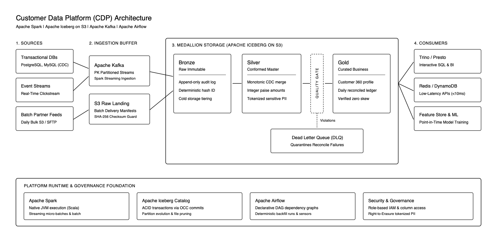

# Customer Data Platform (CDP) - Lakehouse Platform

A lakehouse data platform built with **Apache Spark (Scala)** and **Apache Iceberg**, designed for high-velocity streaming ingestion (10K events/sec) and daily batch processing (~500M rows) on AWS S3.

The platform focuses on three distributed data challenges: **replay-safe ingestion**, **monotonic CDC state reconstruction**, and **single-pass financial quality gates**.

---

## Architecture



The platform follows a standard Medallion architecture:
* **Ingestion Buffer:** Kafka handles streaming CDC and clickstreams; S3 Landing handles daily batch files with manifest checksum validation.
* **Bronze (Raw Immutable):** Stores source-shaped payloads with deterministic ingestion metadata. Raw data is never updated or overwritten.
* **Silver (Conformed Master):** Normalizes schemas, applies monotonic CDC state merges, masks sensitive PII, and deduplicates records.
* **Quality Gate:** Consolidates completeness, uniqueness, referential integrity, and money rules into a single-pass aggregation. Violations are isolated to a Dead Letter Queue (DLQ).
* **Gold (Curated Business Marts):** Aggregates dimensional models, customer 360 profiles, and financial ledgers for analytics and operational caching.

---

## Core Engineering Invariants

The reference implementation under `code/src/` addresses the distributed failure modes common in high-scale lakehouse platforms:

### 1. Replay-Safe Ingestion & Deterministic Identity
* **Problem:** In at-least-once streaming and batch pipelines, retries or task restarts cause duplicate records. Generating random UUIDs duplicates data on retry, while hashing raw JSON strings fails when upstream systems send payload keys in different order (e.g. `{"user_id": "u1", "amount": 100}` vs `{"amount": 100, "user_id": "u1"}`).
* **Implementation ([`Ingestion.scala`](file:///Users/satyamsingh/Documents/customer-data-platform/code/src/main/scala/com/cdp/lakehouse/Ingestion.scala)):**
  * **Canonical Key-Sorted JSON Hashing (`normalizeBronze`):** Columns are sorted alphabetically before serialization to guarantee deterministic strings, producing identical SHA-256 event IDs regardless of source key ordering.
  * **Whitespace/Null Fallback:** Blank or whitespace `source_id` fields fall back to the canonical payload hash, preventing empty-string collisions.
  * **Delivery Manifest Registry (`FileManifestRegistry`):** Tracks batch deliveries by `(source, delivery_id, size, sha256)`. Exact replays return `DuplicateDelivery` (safe no-op); altered payloads under an existing delivery ID trigger a `DeliveryConflictException`.

### 2. Monotonic CDC State Reconstruction & Out-of-Order Merges
* **Problem:** Transactional records mutate rapidly (`Insert` -> `Update` -> `Delete`). When network retries or Kafka rebalances deliver events out of order, a late `Update` could overwrite an earlier `Delete`, corrupting state. Additionally, multiple updates to the same key within a single micro-batch cause ambiguous target matches during SQL merge.
* **Implementation ([`CdcMerge.scala`](file:///Users/satyamsingh/Documents/customer-data-platform/code/src/main/scala/com/cdp/lakehouse/CdcMerge.scala)):**
  * **In-Batch Window Deduplication (`deduplicateMicroBatch`):** Uses `Window.partitionBy(pk).orderBy(transaction_id.desc, sequence_id.desc)` to retain only the newest state per business key prior to merging.
  * **Monotonic Sequence Guard (`buildMergeSql`):** Generates an Iceberg `MERGE INTO` with a predicate guard:
    ```sql
    WHEN MATCHED AND (
      s.transaction_id > t.transaction_id OR
      (s.transaction_id = t.transaction_id AND s.sequence_id > t.sequence_id)
    )
    ```
    Older or duplicate events are rejected from overwriting newer state.
  * **Soft-Delete Tombstones:** Deletions are stored as tombstones (`deleted = true, value = NULL`) while preserving sequence position so subsequent out-of-order events are recognized as obsolete.

### 3. Financial Quality Gates & Scalable Reconciliation
* **Problem:** Storing currency as `Float` or `Double` introduces binary floating-point rounding errors (`0.10 + 0.20 = 0.30000000000000004`), causing ledger drift across millions of transactions. Furthermore, running separate queries for row counts, uniqueness, and invalid amounts forces Spark to scan and shuffle data repeatedly.
* **Implementation ([`QualityGate.scala`](file:///Users/satyamsingh/Documents/customer-data-platform/code/src/main/scala/com/cdp/lakehouse/QualityGate.scala)):**
  * **Single-Pass Distributed Aggregation (`validatePayments`):** Evaluates total rows, primary key uniqueness (`(nonNull - distinct) + nulls`), money validity, and foreign-key presence in a single aggregation pass, minimizing redundant S3 reads and network shuffles.
  * **Strict Integer Paise:** Currency is strictly enforced as `BIGINT` integer paise (1 Rupee = 100 Paise, `>= 0`, non-null), guaranteeing exact ledger arithmetic.
  * **In-Data Freshness SLA (`isFresh`):** Measures data lag directly against event timestamps rather than wall-clock time, flagging stalled upstream pipelines even if ingestion jobs report success.

---

## Tech Stack

| Component | Technology | Version | Purpose |
|---|---|---|---|
| Compute Engine | Apache Spark (Scala) | `3.5.3` | Unified engine for streaming micro-batches and batch backfills |
| Table Format | Apache Iceberg | `1.6.1` | ACID transactions, partition evolution, and time travel |
| Language Runtime | OpenJDK | `17 LTS` | Modern Java runtime for Spark executors |
| Language | Scala | `2.12.19` | Direct JVM execution and static typing |
| Test Framework | ScalaTest | `3.2.19` | Hermetic unit tests for data invariants |
| Streaming | Apache Kafka | `3.7+` | Real-time event and CDC ingestion buffer |
| Orchestration | Apache Airflow | `2.9+` | Batch scheduling and dependency graph management |
| Interactive Query | Trino / Presto | `440+` | Interactive SQL analytics over Gold and Silver |

---

## Repository Structure

```
.
├── code/                               # Reference Implementation (Spark 3.5 + Scala)
│   ├── build.sbt                       # SBT build configuration (Spark 3.5.3, Iceberg 1.6.1, Java 17)
│   └── src/
│       ├── main/scala/com/cdp/lakehouse/
│       │   ├── Ingestion.scala         # Replay-safe Bronze ingestion & file delivery manifests
│       │   ├── CdcMerge.scala          # Monotonic CDC merge, micro-batch dedup & soft deletes
│       │   └── QualityGate.scala       # Single-pass quality gates, integer paise & freshness SLAs
│       └── test/scala/com/cdp/lakehouse/
│           └── LakehouseHardPartsSpec.scala # ScalaTest test suite
├── docs/
│   └── adr/                            # Architectural Decision Records (ADRs)
│       ├── README.md                   # ADR index
│       ├── 0001-apache-iceberg-table-format.md
│       ├── 0002-spark-scala-unified-engine.md
│       ├── 0003-deterministic-replay-safe-ingestion.md
│       └── 0004-integer-paise-currency-representation.md
├── scripts/
│   └── setup-git-hooks.sh              # Configures local pre-push test hook
├── .github/
│   └── workflows/
│       └── ci.yml                      # GitHub Actions CI workflow (Java 17 + SBT test)
├── .githooks/
│   └── pre-push                        # Pre-push test verification hook
├── architecture.png                    # System architecture diagram
├── design.md                           # Detailed platform design document
├── CONTRIBUTING.md                     # Development workflow and commit conventions
└── LICENSE                             # Apache 2.0 License
```

---

## Getting Started

### Prerequisites
* **Java Development Kit (JDK):** Version 17 LTS (or 11+)
* **SBT:** Version 1.9+
* **Git:** Version 2.30+

### Building & Running Tests

Compile the Scala implementation:
```bash
cd code
sbt compile
```

Run the full ScalaTest suite:
```bash
cd code
sbt test
```

### Git Hooks (Optional)

To automatically run tests locally before pushing:
```bash
./scripts/setup-git-hooks.sh
```

---

## Documentation

* **[design.md](file:///Users/satyamsingh/Documents/customer-data-platform/design.md):** Complete architectural design, failure recovery scenarios, scaling considerations, and trust model.
* **[Architectural Decision Records (ADRs)](file:///Users/satyamsingh/Documents/customer-data-platform/docs/adr/README.md):** Detailed trade-offs and rationale for key technical decisions.
* **[CONTRIBUTING.md](file:///Users/satyamsingh/Documents/customer-data-platform/CONTRIBUTING.md):** Branching guidelines, commit message format, and code standards.

---

## License

This project is licensed under the Apache License 2.0. See [LICENSE](file:///Users/satyamsingh/Documents/customer-data-platform/LICENSE) for details.
